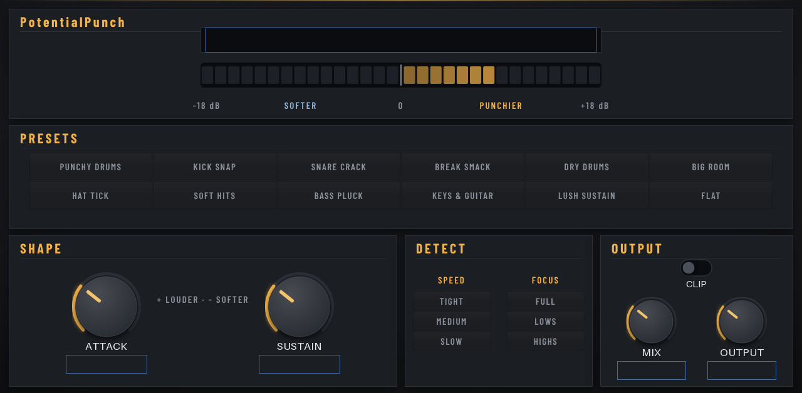

# PotentialPunch

**Punch where you want it.** A transient shaper for your MPC: make every hit snap harder, or soften it, and pull a tail up or tighten it, with no threshold to set. Great on breaks, drum buses, single drums and plucky sounds.

*Insert effect · MPC OS 3.x · Gen1 and Gen2 · v1.5.0*

Free and open source (MIT), made by **PotentialBreaks**. It runs inside the MPC like its own effects, with its own touchscreen page, Q-Link control and project recall, and no computer needed while you play.

**[Download the latest release](../../releases/latest)** · [Install guide](INSTALL-GUIDE.md) · [FAQ](FAQ.md) · [Ideas and bugs](../../issues/new/choose)

## What it does

| Control | What it does |
|---|---|
| **ATTACK** | Turn up for more snap at the start of each hit (up to about +18 dB), down to soften it |
| **SUSTAIN** | Turn up to bring the tail and room up, down to tighten and dry things out |
| **SPEED** | **TIGHT**, **MEDIUM** or **SLOW**: how long the "attack" part lasts and how long the tail is followed |
| **FOCUS** | What it listens to: **FULL**, **LOWS** (kicks, bass) or **HIGHS** (snares, hats). The whole sound is always shaped |
| **CLIP** | A soft clipper after the shaper, to catch the extra peaks and add a little bite |
| **AUTO LEVEL** | Measures how loud the sound is going in and coming out and evens them up, so a punchier setting isn't just louder. On for a new copy; switch it off to let ATTACK make things louder |
| **MIX / OUTPUT** | Blend with the original sound, set the level |
| **ROLL** | One tap for a random setting that still sounds good. **MILD**, **MEDIUM** or **WILD** under it sets how far it goes |

It reacts to how quickly each hit rises and falls, not to how loud the track is, so it works the same on quiet and loud material. A live meter shows the boost or cut as it happens.

**Presets** (one tap on the page, and in the MPC's PRESET menu): Punchy Drums, Kick Snap, Snare Crack, Break Smack, Dry Drums, Big Room, Hat Tick, Soft Hits, Bass Pluck, Keys & Guitar, Lush Sustain and Flat, plus the drum-bus pairs.

**Drum-bus pairs:** Boom Bap Bus, Lo-Fi Bus, Modern Bus and Glue Bus are in both PotentialPunch and PotentialHeat, made to work together. Put Punch first and Heat after it on your drum bus, and pick the same name in each.

**USER presets** (USER page): 8 slots of your own. Tap **SAVE**, then a slot, to keep the sound; tap a slot to bring it back. They're kept in `PotentialSuite Presets/PotentialPunch.txt` beside your VST2 Plugins folder, so every project sees them and updates keep them. The same slot number in each PotentialSuite effect makes a chain of your own.

**MANUAL page:** the manual is on the MPC's screen too. Tap **MANUAL**, then the page buttons along the top. The full [PotentialSuite manual](https://github.com/PotentialBreakfast/potential-plugins/blob/main/MANUAL.md) covers every plugin, the FX chains and a developer reference.

## How to use it

Add it as an **insert effect** on a track, program, pad or bus. It won't be in the instrument list. Tap a preset, then fine-tune **ATTACK** and **SUSTAIN** to taste. On a whole drum bus, **Punchy Drums** or **Break Smack** is a good start.

## Three looks

PotentialPunch comes in three looks: **Print Plate** (the default), **Night Rack** and **Colour Block**. Open the **SETTINGS** page and tap one of the big LOOK keys. The new look shows the next time the plugin loads: take it off the track and add it again, or load your project again. Your choice is kept on your MPC for every project. The sound and the controls are the same in all three.

## Limitations

- **Turning ATTACK up raises the peaks.** AUTO LEVEL keeps the average loudness the same, but the peaks still stick out more: leave **CLIP** on, or lower **OUTPUT**, if the track gets close to clipping.
- **It doesn't look ahead**, so the very first moment of a hit can't be made quieter than the original; it starts working within a fraction of a millisecond.
- **Stereo in, stereo out** (both sides shaped together), at 44.1 kHz. No added delay.
- **Tested on an MPC One only** (Gen1). The 64-bit build for Gen2 MPCs passes Akai's own checks but hasn't been tried on a Gen2 MPC yet.

## Will it work on my MPC?

| | |
|---|---|
| **Tested on** | MPC One (Gen1): with Akai's plugin folder on **MPC OS 3.10.1**, and with the community set-up on HAKAI 3.10 |
| **Should work on** | Any standalone MPC on **MPC OS 3.10.1 or later**: 32-bit (One, One+, Live, Live II, X, Key 61, Key 37) and 64-bit (Live III, XL, One Gen 2, Key 37 Gen 2). Also Gen1 MPCs on older MPC OS 3.x with the community set-up |
| **Not supported** | **MPC OS 2.x** |

The **Should work on** row is untested so far. If you try it on another model, please [tell me how it went](../../issues/new/choose).

## Install

**👉 [Step-by-step install guide](INSTALL-GUIDE.md)**

**On MPC OS 3.10.1 or later** (any standalone MPC, no hacking):
1. Download `PotentialPunch-<version>-akai-vst2.zip` from [**Releases**](../../releases) and unzip it on your computer.
2. On the MPC, turn on **Preferences → Enhancements (Beta) → Enable Enhancements** and **External Plugin Support**.
3. Copy the folder **PotentialBreaks - VST - PotentialPunch** into a folder called **VST2 Plugins** at the top of a USB stick, SD card or the internal drive, and restart.
4. It's in **External Plugins**, as an effect.

**On older MPC OS 3.x (Gen1, community set-up):** download `PotentialPunch-<version>-mpc-armv7.zip` instead and install it with the free **MPC Plugin Installer** from [Open MPC](https://open-mpc.github.io/), or over SSH (see the guide). Save your project first, because installing restarts the MPC app.

Install it one way only, or it shows up twice. Stuck? The [**FAQ**](FAQ.md) covers the common problems.

## Also good to know

- **Made by one person, tested on one MPC.** It works well for me, but you may hit something I haven't. Please tell me if you do.
- **Plugins must be allowed to run on your MPC.** On MPC OS 3.10.1 or later, that's the **External Plugin Support** switch in Preferences → Enhancements (Beta). On older firmware, your MPC needs the community set-up from [Open MPC](https://open-mpc.github.io/), which you may have to redo after a firmware update.
- **No warranty.** It's free and comes as it is. Back up your projects.

## Ideas, bugs and criticism: all welcome

I make these for myself first, and I want them to be good for everyone else too, so **please tell me what you think**, including what you don't like.

- 💡 [Suggest a feature](../../issues/new?template=idea.yml)
- 🐛 [Report a bug](../../issues/new?template=bug.yml)

You don't need to be technical. Short messages are great. See [CONTRIBUTING.md](CONTRIBUTING.md) for more, including how to send code.

## More from PotentialBreaks
- **[PotentialPatina](https://github.com/PotentialBreakfast/mpc-vst-potentialpatina)**: Retro-colour insert effect: vinyl and tape noise, wobble, drive, bit-crush, tone and room in one box.

- **[PotentialBreaks](https://github.com/PotentialBreakfast/mpc-vst-potentialbreaks)**: Drum-break slicer: a random break from your library on 16 pads, chopped and tempo-matched.
- **[PotentialWax](https://github.com/PotentialBreakfast/mpc-vst-potentialwax)**: Melodic sampler: pick or dig a song from your library, 16 cues found for you, matched to your tempo and key.
- **[PotentialNoise](https://github.com/PotentialBreakfast/mpc-vst-potentialnoise)**: Calibrated pink noise reference for mixing: one-tap RMS levels, mono/stereo, full or limited range, live meter.
- **[PotentialHeat](https://github.com/PotentialBreakfast/mpc-vst-potentialheat)**: Soft clipper and bus saturator: warmth, glue and loudness without clipping, with one-tap presets.
- **[PotentialWarp](https://github.com/PotentialBreakfast/mpc-vst-potentialwarp)**: Tempo-locked mangler: stutters, half speed, tape stops, spinbacks, reverses and gates in 16 one-tap patterns.
- **[MPC TOOLS](https://github.com/PotentialBreakfast/mpc-tools)**: a free second-screen app for Windows: your MPC's screen live on your PC (and in OBS), file transfer, your PC's folders on the MPC, and one-click "save the last 60 seconds".

## Build it yourself

See [BUILD.md](BUILD.md).

## Credits

- Built on **[mpc-vst-plugins](https://github.com/sd88me/mpc-vst-plugins)** by sd88me (MIT), the open kit that makes MPC plugins possible: the plugin wrapper, skin builder and installer.
- Fonts: **Jost**, **DM Mono**, **IBM Plex Sans Condensed**, **IBM Plex Mono**, **Bricolage Grotesque** and **Space Mono** (SIL Open Font License 1.1), in `vst/skin/looks/fonts/` with their licences.
- The dark look grew out of the theme I made for sd88me's Lucky Dip.
- Made with help from Claude (Anthropic).

Not affiliated with or endorsed by Akai Professional or inMusic. MPC is their trademark.

## Licence

[MIT](LICENSE): free to use, change and share, including in your own projects. Third-party parts keep their own licences ([THIRD_PARTY.md](THIRD_PARTY.md)).
